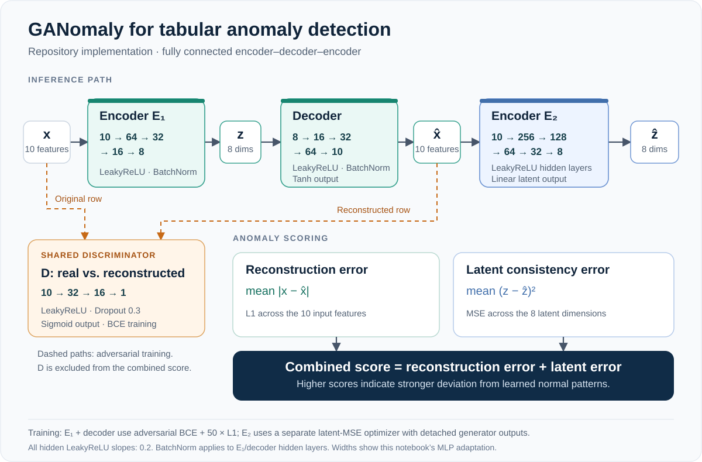
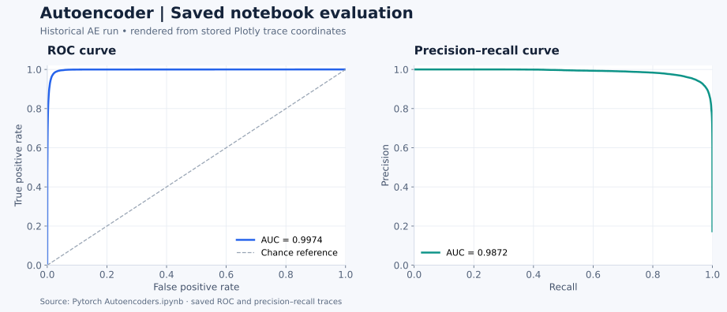

# GANomaly for Tabular Anomaly Detection

**Learning normal sensor behaviour for predictive maintenance.** A PyTorch adaptation of GANomaly for 10-feature industrial sensor observations, with Autoencoder and β-VAE baselines.


[Architecture](#architecture) · [Notebooks](#explore-the-notebooks) · [Run locally](#run-locally) · [Evaluation](#evaluation-and-saved-results)

## Architecture

[](docs/assets/ganomaly-tabular-architecture.svg)

*The architecture implemented in the GANomaly notebook. Open the diagram for the full-size view.*

The model learns to reconstruct normal sensor observations, then compares the original and reconstructed observations in both **input space** and **latent space**. Larger reconstruction or latent mismatch provides an anomaly signal.

| Component | Layer widths | Role |
| --- | --- | --- |
| First encoder, E₁ | `10 → 64 → 32 → 16 → 8` | Compress an observation into an 8-dimensional latent vector |
| Decoder | `8 → 16 → 32 → 64 → 10` | Reconstruct the sensor observation |
| Second encoder, E₂ | `10 → 256 → 128 → 64 → 32 → 8` | Encode the reconstruction for latent comparison |
| Discriminator | `10 → 32 → 16 → 1` | Distinguish real normal observations from reconstructions during training |

This is a **GANomaly-inspired tabular MLP adaptation** of the [original image-based method](https://arxiv.org/abs/1805.06725). The two encoders have different architectures. Training uses adversarial BCE and reconstruction L1 for the encoder–decoder, then fits the second encoder separately using latent MSE and detached encoder–decoder outputs. See the [architecture notes](docs/architecture.md) for activations, loss weights and the exact training flow.

### How an observation becomes an anomaly score

```text
z     = E₁(x)
x_hat = Decoder(z)
z_hat = E₂(x_hat)

reconstruction_score = mean(abs(x - x_hat))
latent_score         = mean((z - z_hat)²)
combined_score       = reconstruction_score + latent_score
```

The notebook evaluates **latent-only** and **combined** scores. It also computes the discriminator output separately; that output is not included in the combined score.

## What the project explores

- **Normal-only model training:** learn from observations labeled normal, then score held-out normal observations and anomalies.
- **Three neural approaches:** reconstruction with an Autoencoder, probabilistic latent modelling with a β-VAE, and adversarial reconstruction with the tabular GANomaly adaptation.
- **Latent-space analysis:** t-SNE/UMAP visualizations and VAE experiments with Gaussian Mixture Models, Mahalanobis distance and One-Class SVM.
- **Anomaly evaluation:** ROC and precision–recall curves, F1-based threshold exploration, and reconstruction/latent score distributions.

## Explore the notebooks

| Notebook | What to explore |
| --- | --- |
| [Tabular GANomaly](Pytorch%20%20GANomaly_nooutput.ipynb) | Encoder–decoder–encoder architecture, adversarial training, checkpointing and latent/combined anomaly scores |
| [Autoencoder baseline](Pytorch%20Autoencoders.ipynb) | MSE reconstruction baseline, saved training outputs and evaluation curves |
| [β-VAE experiments](Pytorch%20Variational%20Autoencoders_noutput.ipynb) | Reconstruction/KL trade-offs, latent visualizations and statistical novelty detectors |

The notebooks retain their original filenames and implementation. GANomaly is the main architectural focus of this overview; the other notebooks provide complementary experiments.

## Data and preprocessing

The project uses the [ARAMIS degradation challenge](https://aramis3d.com/wp-content/uploads/2022/07/Aramis-Challenge.pdf), which simulates interacting industrial components monitored by 10 sensor signals. Its labeled development data contains 200 systems with four components per system.

The notebooks load **`train.mat`**, extract `Train_data`, and turn each trajectory time step into a **10-feature tabular row**:

```text
MATLAB trajectories + labels
          ↓
Normal rows (label 0) ──→ 80% training / 20% held-out normal rows
Anomalous rows (label 1) ───────────────────→ anomaly evaluation
          ↓
MinMaxScaler [-1, 1], fitted on normal training rows
          ↓
Train models → compute anomaly scores → inspect ROC / PR / F1
```

The implemented task is observation-level anomaly detection. The split is by row, so related observations from one trajectory can occur in both training and evaluation. System-level validation and temporal onset detection are useful next steps.

## Evaluation and saved results

The [Autoencoder notebook](Pytorch%20Autoencoders.ipynb) preserves a historical run with these saved outputs:

| ROC-AUC | PR curve AUC | F1 |
| :---: | :---: | :---: |
| **0.9974** | **0.9872** | **0.9466** |

These values belong to the **Autoencoder baseline**. The GANomaly and β-VAE notebooks were committed without saved execution outputs, so this repository does not establish a numerical ranking between the three models. F1 uses a threshold selected on the same labeled evaluation samples; use separate calibration data for an independent final assessment.

[](docs/assets/ae-saved-evaluation.svg)

*Autoencoder baseline: a static rendering of the saved notebook's ROC/PR trace coordinates and AUC labels. [Figure provenance](docs/assets/ae-saved-evaluation.provenance.json).*

<details>
<summary>Additional project latent-space visualizations</summary>

The original project overview included these exploratory views. They are retained here as visual context, separately from the saved Autoencoder metrics above.


</details>

## Run locally

```bash
git clone https://github.com/ADHU-ADHU/Anomaly-Detection-Tabular-Data-.git
cd Anomaly-Detection-Tabular-Data-
python -m venv .venv
source .venv/bin/activate
python -m pip install torch numpy scipy pandas scikit-learn matplotlib plotly tqdm seaborn umap-learn jupyterlab
jupyter lab
```

On Windows, activate the environment with `.venv\Scripts\activate`.

Place your copy of **`train.mat` beside the notebooks**, then open the GANomaly notebook and run its cells in order. The notebooks select CUDA when available and otherwise use CPU. The dataset and trained checkpoints are not included in this repository.

The installation command lists the imported packages; the original dependency versions are not pinned. The [reproduction guide](docs/reproducibility.md) covers dataset structure, checkpoint handling and evaluation details.

## Further work

- Split and validate by system or trajectory, with a separate threshold-calibration set.
- Compare all models under matched data splits, seeds and training budgets.
- Explore temporal windows and abnormal-state onset detection.
- Study joint latent regularization and the relative weighting of reconstruction and latent scores.

## References

- Akçay, Atapour-Abarghouei and Breckon — [GANomaly: Semi-Supervised Anomaly Detection via Adversarial Training](https://arxiv.org/abs/1805.06725), ACCV 2018.
- Cannarile et al. — [The Aramis Challenge: Prognostics and Health Management in Evolving Environments](https://aramis3d.com/wp-content/uploads/2022/07/Aramis-Challenge.pdf).

Developed by **[Adhithya Palanisamy Chandrasekaran](https://github.com/ADHU-ADHU)**.
